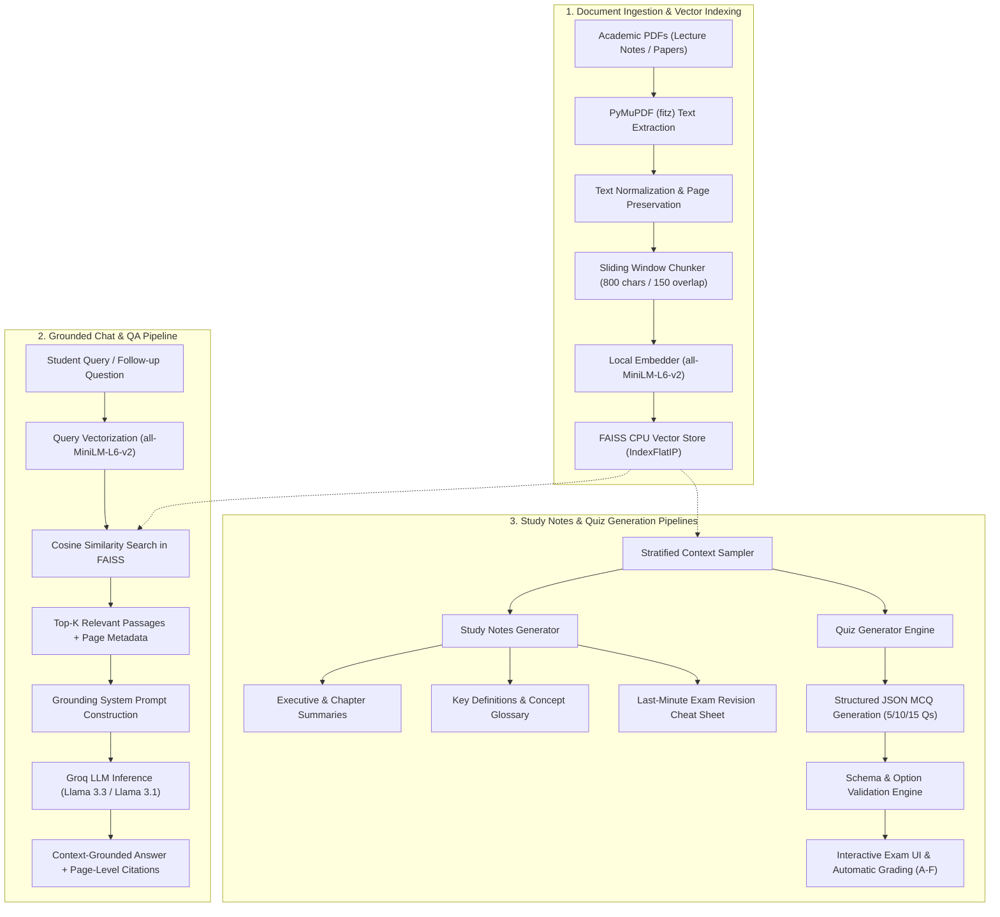

# StudyRAG — Intelligent RAG-Based Study Assistant

> **"Your personal AI-powered study companion."**  
> An end-to-end, locally indexed Retrieval-Augmented Generation (RAG) platform tailored for students to understand lengthy academic PDFs, lecture slides, and research papers through grounded conversational QA, automated chapter study notes, exam revision cheat sheets, and syllabus-aligned multiple-choice quizzes.

---

## 1. Project Overview & Problem Statement

University students frequently face the overwhelming task of studying from hundreds of pages of lecture slides, textbook chapters, and academic research papers. Manually skimming, searching, cross-referencing, and synthesizing study materials for examinations is inefficient, error-prone, and exhausting.

Generic AI chatbots (like standard ChatGPT or vanilla LLM interfaces) fail to solve this problem effectively because:
1. **Hallucinations & Speculation**: Standard LLMs invent plausible-sounding facts, fabricated statistics, and fake references.
2. **Knowledge Cutoffs**: Foundation models know nothing about specific course slides, professor-curated notes, or internal university assignments.
3. **No Verifiability**: A basic LLM cannot cite the exact PDF name and page number where an answer originated.

**StudyRAG** solves this problem by implementing a true **Retrieval-Augmented Generation (RAG)** pipeline:
- Ingests multiple academic PDFs.
- Parses and preserves exact original page numbers.
- Computes high-dimensional dense embeddings locally with zero data leakage.
- Indexes vectors in-memory with high-speed FAISS CPU similarity search.
- Retrieves the most relevant passages for any query and feeds them into a grounded LLM prompt (powered by Groq).
- Formulates accurate answers backed by **verifiable, page-level citations** that can be inspected directly in the UI.

---

## 2. System Architecture



---

## 3. Key Features

- **Multi-PDF Document Management**: Upload, inspect, filter, and remove multiple course PDFs. Scanned/image-only PDFs and encrypted files are detected and handled with clear guidance.
- **True Page-Level Citations**: Every answer provides clickable source cards indicating the exact source document, page number, similarity score, and verbatim excerpt.
- **Interactive Conversational Memory**: Supports follow-up questions while ensuring that conversational history never overrides factual document grounding.
- **Source Filtering & Top-K Tuning**: Query across all active documents or filter exclusively to selected lecture notes. Adjust retrieval depth ($k=2$ to $8$).
- **Structured Study Notes**:
  - Executive Summaries (core objectives & key takeaways).
  - Detailed Chapter Breakdowns.
  - Key Academic Concept Extractors.
  - Definitions & Terminology Glossary tables.
- **Exam Revision Tools**:
  - High-Yield Exam Points (commonly tested questions and edge cases).
  - Mathematical Formulas & Big-O Complexity tables (explicitly notes when no formulas exist).
  - Practice Short-Answer Flashcards with model answers.
  - 1-Page Last-Minute Cheat Sheet.
- **Multiple-Choice Quiz Generator**:
  - Generates 5, 10, or 15 MCQs at Easy, Medium, or Hard difficulty.
  - Strict Python schema validation ensures exactly 4 distinct options, unambiguous correct answers, and thorough explanations.
  - Interactive quiz simulator with real-time scoring, percentage, letter grades ($A^+$ through $F$), and detailed explanations.
- **One-Click Markdown Downloads**: Export generated study notes and revision sheets as `.md` files for offline review.
- **Modern Academic UI**: Responsive design with clean metrics, custom cards, intuitive navigation, and status badges.

---

## 4. Technology Stack

| Component | Technology | Rationale |
| :--- | :--- | :--- |
| **Frontend & App Framework** | Streamlit | Rapid, stateful, reactive Python UI for AI applications. |
| **PDF Extraction** | PyMuPDF (`fitz`) | High-speed, robust PDF parsing with precise per-page text tracking. |
| **Local Embeddings** | Sentence-Transformers (`all-MiniLM-L6-v2`) | Fast, local 384-dimensional dense semantic vectors with zero API cost. |
| **Vector Similarity Search** | FAISS CPU (`IndexFlatIP`) | Highly optimized local cosine similarity search over normalized vectors. |
| **LLM Inference** | Google Gemini (`gemini-3.8-flash`) & Groq (`llama-3.3-70b`) | Fast conversational RAG, summaries, and MCQs with offline fallback. |
| **Environment Management** | `python-dotenv` | Secure API key isolation from source code. |
| **Testing** | `pytest` | 26 automated tests validating extraction, chunking, retrieval, LLM clients, and grading. |

---

## 5. Setup & Installation (Windows / VS Code)

Follow these exact steps in PowerShell from the project root:

### Step 1: Create Virtual Environment
```powershell
py -3.12 -m venv .venv
```
*(If you are running Python 3.11, 3.12, or 3.14, `python -m venv .venv` works equally well).*

### Step 2: Activate Environment
```powershell
.\.venv\Scripts\Activate.ps1
```
> **PowerShell ExecutionPolicy Note:** If PowerShell blocks script execution with a security warning, run the activation using the bypass flag:
> ```powershell
> powershell -ExecutionPolicy Bypass -File .\.venv\Scripts\Activate.ps1
> ```
> Or use Command Prompt:
> ```cmd
> .venv\Scripts\activate.bat
> ```

### Step 3: Upgrade pip & Install Dependencies
```powershell
python -m pip install --upgrade pip
pip install -r requirements.txt
```

### Step 4: Configure Environment Variables
Copy the template configuration file:
```powershell
Copy-Item .env.example .env
```
Open `.env` in VS Code and set your preferred provider (`gemini` or `groq`):
```env
# Default provider ('gemini' recommended or 'groq')
LLM_PROVIDER=gemini

# Google Gemini API Key (Obtain from https://aistudio.google.com/apikey)
GEMINI_API_KEY=your_gemini_api_key_here
GEMINI_MODEL=gemini-3.8-flash

# Groq API Key (Optional alternative from https://console.groq.com/keys)
GROQ_API_KEY=
GROQ_MODEL=llama-3.3-70b-versatile

# Local Embeddings & Vector Search
EMBEDDING_MODEL=sentence-transformers/all-MiniLM-L6-v2
CHUNK_SIZE=800
CHUNK_OVERLAP=150
TOP_K_RETRIEVAL=5
```
*(You can also enter or switch API keys and models directly in the application's sidebar at runtime).*

---

## 6. Running the Application

Launch the Streamlit web dashboard:
```powershell
streamlit run app.py
```
Open your browser to: `http://localhost:8501`.

---

## 7. Running the Automated Test Suite

Run all unit and integration tests with detailed verbose output:
```powershell
python -m pytest -v
```

The automated test suite verifies:
- `test_pdf_processor.py`: Multi-page text extraction, page-number preservation, empty files, corrupted headers, and scanned/image PDF detection.
- `test_text_chunker.py`: Sliding window character splitting, overlap preservation, page number assignment, and metadata integrity.
- `test_rag_engine.py`: Vector store indexing, cosine similarity retrieval, document filtering, document removal, prompt grounding, citation generation, and missing API key exceptions.
- `test_quiz_generator.py`: Structured JSON validation, option letter mapping, malformed question discard, duplicate deduplication, and grade scoring.
- `test_e2e_pipeline.py`: Full end-to-end integration test parsing `sample_docs/lecture_notes_rag.pdf`, embedding, and verifying exact page citations.

---

## 8. Troubleshooting & Common Issues

| Issue | Cause | Solution |
| :--- | :--- | :--- |
| `ImportError: DLL load failed while importing _swigfaiss` | OpenMP runtime collision between PyTorch and FAISS on Windows | StudyRAG automatically handles this via `os.environ["KMP_DUPLICATE_LIB_OK"] = "TRUE"` in `config.py` and `conftest.py`. |
| `Scanned document detected` warning | PDF contains scanned images or bitmaps without digital text | Convert the scanned PDF with OCR (e.g. Adobe Acrobat, Tesseract) before uploading. |
| `Groq Authentication Failed` | Missing or invalid Groq API key | Paste a valid key in `.env` or in the sidebar settings expander. |
| `Groq Rate Limit Reached` | Free-tier token per minute (TPM) limit reached | Switch to `llama-3.1-8b-instant` in the sidebar for higher rate limits and faster responses. |

---

## 9. Project Structure

```
StudyRAG/
├── app.py                      # Main Streamlit dashboard & page controllers
├── config.py                   # Central configuration, environment loading, and paths
├── requirements.txt            # Frozen compatible Python dependencies
├── .env.example                # Sample environment template
├── .gitignore                  # Git ignore rules for caches, venv, and indexes
├── README.md                   # Complete architectural and operational manual
├── PROJECT_EXPLANATION.md      # In-depth viva / conceptual guide for students
├── DEMO_GUIDE.md               # Step-by-step viva & professor demonstration guide
├── assets/
│   └── style.css               # Modern custom academic CSS theme
├── data/
│   ├── uploads/                # Directory for uploaded course files
│   └── indexes/                # Directory for saved FAISS vector indexes
├── sample_docs/
│   └── lecture_notes_rag.pdf   # Pre-generated 3-page academic PDF for instant demos
├── src/
│   ├── __init__.py             # Source package initializer
│   ├── pdf_processor.py        # PyMuPDF text extractor & page tracking
│   ├── text_chunker.py         # Overlapping chunker preserving page boundaries
│   ├── vector_store.py         # SentenceTransformers & FAISS CPU vector index
│   ├── rag_engine.py           # Core RAG grounding, prompt assembly & citations
│   ├── study_notes.py          # Summaries, definitions, and concepts generator
│   ├── revision_tools.py       # High-yield points, formulas, and flashcards
│   ├── quiz_generator.py       # Multiple-choice exam generator, validator & grader
│   ├── llm_client.py           # Groq API client with JSON repair and fallback
│   └── utils.py                # Text sanitizers, hashing, and markdown export
└── tests/
    ├── conftest.py             # Pytest setup and Windows OpenMP environment fixtures
    ├── test_pdf_processor.py   # PDF extraction unit tests
    ├── test_text_chunker.py    # Chunking & overlap unit tests
    ├── test_rag_engine.py      # Vector search & RAG pipeline unit tests
    ├── test_quiz_generator.py  # MCQ validation and scoring unit tests
    └── test_e2e_pipeline.py    # End-to-end integration test with sample PDF
```

---

## 10. Limitations & Future Work

- **OCR Integration**: Current extraction handles digital text PDFs; future iterations can integrate `Tesseract` or `easyocr` for scanned paper notes.
- **Hybrid Search**: Combine dense embeddings with sparse BM25 retrieval (hybrid search with Reciprocal Rank Fusion) for improved keyword lookup.
- **Multimodal RAG**: Extract and index diagrams, architectural charts, and formulas using Vision LLMs.
